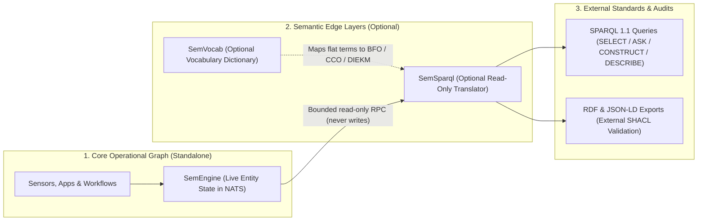

# SemSparql

SemSparql (`github.com/c360studio/semsparql`) is an **optional, read-only** HTTP server and Go library that adds a
[W3C SPARQL 1.1 Protocol](https://www.w3.org/TR/sparql11-protocol/) endpoint and RDF / JSON-LD export routes at the
edge of a live SemEngine graph.

## What's in it for you (the problem we solve)

Semantic-web standards—Resource Description Framework (RDF, a standard graph format of subject-predicate-object
triples), standard ontologies, SPARQL queries, and Shapes Constraint Language (SHACL, a rule checker for RDF graphs)—let
independent systems and auditors agree on what data means and verify that it follows strict rules.

In practice, putting semantic-web formats inside a core operational database forces every application and every engineer
to read and write multi-step ontology graphs just to store everyday state. SemEngine avoids that trap by keeping the
core engine simple and making `SemVocab` and `SemSparql` **optional layers at the read-only edge**:

1. **Core operations stay fast and standalone:** SemEngine runs on its own over NATS JetStream, storing entities with
   six-part dot-separated IDs (`org.platform.system.domain.type.instance`) and flat dotted predicates
   (`intel.measurement.altitude-m`). You do not need `SemVocab` or `SemSparql` to run SemEngine or build applications on
   it.
2. **Engineers build without paying the ontology tax:** Application and data teams work with practical entity state in
   SemEngine instead of authoring RDF blank-node chains or SPARQL queries in core services.
3. **Standards and compliance when a project requires them:** When a partner integration, analyst tool, or compliance
   gate requires standard vocabularies—such as Basic Formal Ontology 2.0 (BFO 2.0), Common Core Ontologies (CCO), or the
   Defense Intelligence Enterprise Knowledge Model (DIEKM)—you attach `SemVocab` and `SemSparql` at the edge without
   changing how SemEngine stores data.
4. **Read-only access with per-request limits:** `SemSparql` never writes to SemEngine (`TestScanPatternReaderParity` in
   [`reader/nats_test.go`](reader/nats_test.go)) and enforces hard per-request scan, result, and timeout budgets
   (`TestQueryLimits` in [`server/server_test.go`](server/server_test.go)). External queries and compliance exports
   cannot mutate live state or run unbounded scans.

## How SemEngine, SemVocab, and SemSparql work together



- **SemEngine (Core — Standalone):** The live operational graph where applications and streams read and write entity
  state over NATS. It has no dependency on RDF or SPARQL runtimes.
- **SemVocab (Vocabulary Dictionary — Optional):** Defines how SemEngine's practical entity types (`intel.platform`) and
  flat dotted predicates (`intel.measurement.altitude-m`) map to standard ontology classes and multi-step RDF chains
  (`semvocab v0.2.1`).
- **SemSparql (SPARQL & Export Sidecar — Optional):** Sits beside SemEngine as a read-only translator. It translates
  incoming SPARQL 1.1 queries (`SELECT`, `ASK`, `CONSTRUCT`, `DESCRIBE`) and export requests into bounded NATS RPC reads
  against SemEngine's `graph-ingest` query service (`semengine v0.1.0-alpha.2`, verified by
  `TestRunEndToEndWithLiveNATSAndGraphIngest` in [`cmd/semsparql/main_test.go`](cmd/semsparql/main_test.go)), expands
  registered `SemVocab` ontology chains on demand, and serializes Turtle, N-Triples, or JSON-LD through
  `semengine/vocabulary/export`.

## 60-second quickstart

Start `semsparql` against a NATS server where SemEngine's `graph-ingest` query responder is running:

```bash
go run ./cmd/semsparql \
  -nats-url nats://127.0.0.1:4222 \
  -bind 127.0.0.1:8080
```

Run a SPARQL 1.1 `SELECT` query (`POST /sparql`):

```bash
curl --fail -sS -X POST "http://127.0.0.1:8080/sparql" \
  -H "Content-Type: application/sparql-query" \
  -H "Accept: application/sparql-results+json" \
  --data-binary 'PREFIX diekm: <https://w3id.org/c360/diekm#> SELECT ?s WHERE { ?s a diekm:IntelligencePlatform } LIMIT 10'
```

Fetch a single six-part entity ID as an unfolded JSON-LD document (`GET /entities/{entity_id}.jsonld`):

```bash
curl --fail -sS "http://127.0.0.1:8080/entities/c360.ops.uas1.intel.platform.alpha.jsonld"
```

## Technical documentation

- [Usage and Technical Reference](docs/usage.md) — full command-line flag table, HTTP endpoints and content negotiation
  (`GET/POST /sparql`, `GET /entities/{entity_id}.jsonld`, `POST /export`), `422` budget and truncation headers, Go
  library usage, and the supported/rejected SPARQL 1.1 subset.
- [Architecture and Package Guide](docs/architecture.md) — package layout (`irimap`, `reader`, `sparql`, `server`,
  `cmd/semsparql`), entity-ID-to-IRI mapping, deterministic blank nodes, query access planning, chain folding, and
  resource limits.
- [External SHACL Compliance Gate Guide](docs/shacl-compliance-gate.md) — how to export unfolded Turtle, N-Triples, or
  JSON-LD graphs from SemSparql and validate them with `pyshacl` or Apache Jena `shacl`.
- [Testing and Verification Guide](docs/testing.md) — unit, property-based (`rapid`), fuzz, and live NATS/DIEKM
  integration test suites (`task verify`).
