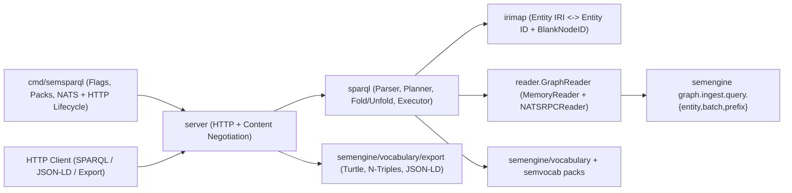

# SemSparql Architecture

SemSparql (`github.com/c360studio/semsparql`) is the read-only SPARQL 1.1 Protocol and JSON-LD query and export sidecar
for SemEngine. In SemEngine's architecture, the core runtime stores each entity as a six-part dot-separated identifier
(`org.platform.system.domain.type.instance`) and flat dotted predicates (`intel.measurement.altitude-m`) rather than an
RDF graph. SemSparql sits at the export edge: it translates incoming SPARQL 1.1 queries into bounded entity reads,
projects stored entities into standard RDF triples on demand, and serializes results using SemEngine's own exporter. It
never writes to the graph.

As of Task 4.1, all five runtime packages and the standalone binary (`irimap`, `reader.GraphReader`,
`reader.MemoryReader`, `reader.NATSRPCReader`, `sparql`, `server`, and `cmd/semsparql`) are present in the tree. The
dedicated `-tags=integration` DIEKM end-to-end test suite lands in Task 4.2.

## Package boundaries and data flow

SemSparql splits query and export execution across four library packages plus the CLI entrypoint so that identity rules,
storage access, SPARQL evaluation, HTTP transport, and process wiring remain testable in isolation.



- **[`irimap`](../irimap/mapper.go)** maps between SemEngine's six-part entity IDs and RDF Internationalized Resource
  Identifiers (IRIs, the globally unique web addresses used as RDF subjects, predicates, and objects), and computes
  deterministic blank-node identifiers (`BlankNodeID`).
- **[`reader`](../reader/reader.go)** defines `GraphReader`, the narrow read-only interface over entity states.
  `MemoryReader` ([`reader/memory.go`](../reader/memory.go)) serves deterministic in-memory snapshots for unit tests and
  embedded callers. `NATSRPCReader` ([`reader/nats.go`](../reader/nats.go)) implements the same interface over
  SemEngine's declared `graph.QueryVerbs()` (`entity`, `batch`, and `prefix`) using classified NATS RPC
  (`RequestClassified`), opaque cursor pagination, and startup `VerifyPatternCapability`.
- **[`sparql`](../sparql/executor.go)** parses the supported SPARQL 1.1 read-only query subset, plans constrained entity
  reads, folds complete ontology reification chains, falls back to virtual graph unfolding when a query inspects partial
  chains, and evaluates `SELECT`, `ASK`, `CONSTRUCT`, and `DESCRIBE`.
- **[`server`](../server/server.go)** serves `GET /sparql`, `POST /sparql`, `GET /entities/{entity_id}.jsonld`, and
  `POST /export`, enforces input byte limits and execution budgets, and delegates all RDF graph serialization to
  `semengine/vocabulary/export`.
- **[`cmd/semsparql`](../cmd/semsparql/main.go)** parses operator flags, validates non-local bind authentication,
  registers the built-in BFO/CCO Core and DIEKM vocabulary packs, verifies superclass closure and server pattern
  capability before accepting traffic, and manages bounded NATS and HTTP shutdown.

## Identity and blank-node mapping (`irimap`)

SemSparql never invents its own entity IRI format. [`irimap.Mapper.EntityIDToIRI`](../irimap/mapper.go) delegates
forward conversion directly to `export.SubjectIRI(entityID, baseIRI)` in `semengine/vocabulary/export` (verified at
`semengine v0.1.0-alpha.2` by `TestIRIMapperMatchesExporter` and `TestPropIRIMapperRoundTrip` in
[`irimap/mapper_test.go`](../irimap/mapper_test.go)):

```text
c360.ops.uas1.intel.platform.alpha
  <-> https://semengine.local/entities/c360/ops/uas1/intel/platform/alpha
```

[`irimap.Mapper.IRIToEntityID`](../irimap/mapper.go) inverts that path and validates the resulting six-part identifier
with `message.ParseEntityID` before any reader call runs. It rejects raw percent-encoded path segments, query strings,
fragments, non-matching base IRIs, and non-entity `/subjects/...` fallback paths.

Upper ontologies such as Basic Formal Ontology 2.0 (BFO 2.0) and Common Core Ontologies (CCO) represent a single numeric
or role attribute as a chain of intermediate RDF blank nodes (anonymous resources written `_:label` that link an entity
to a role, quality, or measurement node). [`irimap.BlankNodeID`](../irimap/bnode.go) derives each intermediate blank
node deterministically from the source triple and zero-based step index:

```text
"_:b_" + hex(sha256(entityID + "\x00" + dottedPredicate + "\x00" + canonicalNTriplesObject + "\x00" + strconv.Itoa(stepIdx))[:16])
```

`irimap.CanonicalNTriplesObject` obtains `canonicalNTriplesObject` by serializing a single probe triple through
`export.SerializeToString(..., export.NTriples)` (verified at `semengine v0.1.0-alpha.2` by
`TestProbeCanonicalNTriplesObjectSeam` in [`internal/harness/contract/probes_test.go`](../internal/harness/contract/probes_test.go)
and `TestBlankNodeIDMultiValued` in [`irimap/mapper_test.go`](../irimap/mapper_test.go)). Because the hash
input uses the exporter's own N-Triples object token, `float64(1500.5)` and `1500.5` produce the same blank node across
`SELECT`, `CONSTRUCT`, `DESCRIBE`, `GET /entities/{entity_id}.jsonld`, and `POST /export`.

## Constrained storage access (`reader`)

[`reader.GraphReader`](../reader/reader.go) exposes five read-only operations:

1. `GetEntity(ctx, id)` fetches one entity by its exact six-part ID.
2. `GetBatch(ctx, ids)` fetches a sorted, deduplicated batch of exact six-part IDs.
3. `ScanPrefix(ctx, prefix, limit)` scans entities under a validated 1-to-6 segment dot-separated prefix (`c360.ops`).
4. `ScanPattern(ctx, pattern, limit)` scans entities matching a six-slot wildcard pattern (`c360.ops.*.intel.platform.*`
   or `*.*.*.*.*.*`).
5. `EntitiesByPredicate(ctx, predicate, limit)` returns entities carrying a specific dotted predicate.

Every selector is validated before execution using SemEngine's shared validators (`types.ValidateEntityID`,
`types.ValidateEntityIDPrefix`, and `types.ValidateEntityIDPattern`, verified at `semengine v0.1.0-alpha.2` by
`TestPinnedUpstreamSeamsSmoke` in [`internal/harness/contract/deps_test.go`](../internal/harness/contract/deps_test.go),
`TestMemoryReaderInvalidInput` in [`reader/reader_test.go`](../reader/reader_test.go), and
`TestNATSRPCReaderConstructorAndInputValidation` in [`reader/nats_test.go`](../reader/nats_test.go)). Complete entity-ID
sets are sorted and deduplicated before `limit` is applied, and exceeding a caller's scan budget returns
`reader.ErrScanBudgetExceeded`. `NATSRPCReader` resolves query subjects exclusively from `graph.QueryVerbs()`, paginates
until `NextCursor == ""` without treating a short byte-trimmed page as exhaustion, and fails closed with
`reader.ErrPatternCapabilityUnsupported` if a server returns an entity outside the requested selector
(`TestScanPatternReaderParity` and `TestNATSRPCReaderShortPagesContinuationAndFailClosed` in
[`reader/nats_test.go`](../reader/nats_test.go)).

## Query planning, folding, and virtual unfolding (`sparql`)

### Supported SPARQL 1.1 subset

[`sparql.Parse`](../sparql/parser.go) parses read-only SPARQL 1.1 `SELECT`, `ASK`, `CONSTRUCT` (including
`CONSTRUCT WHERE`), and `DESCRIBE` queries with `BASE`, `PREFIX`, Basic Graph Patterns (BGPs, sets of triple patterns
that must match together), `OPTIONAL`, `UNION`, `FILTER` (`=`, `!=`, `<`, `<=`, `>`, `>=`, `&&`, `||`, `!`, `BOUND`,
`isIRI`/`isURI`, `isBlank`, `isLiteral`, `STR`, `LANG`, `DATATYPE`, `REGEX`, `CONTAINS`, `STRSTARTS`, `STRENDS`),
`RDF.type` shorthand `a`, property paths `rdf:type/rdfs:subClassOf*` and standalone `rdfs:subClassOf*`, `DISTINCT`,
`ORDER BY`, `LIMIT`, and `OFFSET`.

Out-of-scope SPARQL 1.1 features (SPARQL Update, `SERVICE`, `GRAPH`, `FROM`, `GROUP BY`, `HAVING`, aggregates,
subqueries, `VALUES`, `BIND`, `MINUS`, `REDUCED`, and arbitrary property paths) are rejected at parse time with an
`UnsupportedFeatureError` naming the rejected construct (`TestUnsupportedFeatureErrors` in
[`sparql/parser_test.go`](../sparql/parser_test.go)).

### Access priority

[`sparql.PlanBGPWithScope`](../sparql/planner.go) orders triple patterns and folded chains by selectivity so that
queries avoid full scans whenever a more specific access path exists:

1. **`AccessExactEntity`**: the subject is a bound entity IRI or a previous step already bound the subject variable.
2. **`AccessTypePattern`**: the pattern is `?s rdf:type <ClassIRI>` or `?s rdf:type/rdfs:subClassOf* <ClassIRI>` and
   `<ClassIRI>` resolves through `vocabulary.ListRegisteredEntityTypes()` to one or more `(domain, type)` pairs,
   producing `<org>.<platform>.*.<domain>.<type>.*` patterns.
3. **`AccessPredicate`**: the predicate is a known IRI that resolves through `vocabulary.LookupByIRI` or a registered
   `ProjectionSpec` step/value IRI to candidate dotted predicates. Multiple dotted predicates sharing a `StandardIRI`
   are unioned and deduplicated (`TestLookupByIRIMultiMatchUnion` in
   [`sparql/executor_test.go`](../sparql/executor_test.go)).
4. **`AccessFullScan`**: unconstrained patterns such as `?s ?p ?o` scan `*.*.*.*.*.*` under the per-query entity scan
   budget (`MaxScanEntities`).

### Virtual `rdf:type` and subclass closure

SemEngine entities encode their domain and type in segments 4 and 5 of the six-part entity ID rather than storing an
explicit `rdf:type` triple. [`sparql.VirtualTypeIRIsForEntityID`](../sparql/types.go) resolves `domain.type` via
`vocabulary.GetEntityTypeMetadata` (and any `WildcardTypes` fallback registered in `semvocab` packs, verified at
`semvocab v0.1.0` by `TestPinnedUpstreamSeamsSmoke` in
[`internal/harness/contract/deps_test.go`](../internal/harness/contract/deps_test.go)) and expands transitive `Superclasses`.
Explicit stored `rdf:type` triples and virtual `rdf:type` triples are merged as an RDF set without duplicate solutions.
At startup, [`sparql.ValidateSuperclassClosure`](../sparql/types.go) verifies that every registered entity type's
`Superclasses` list is transitively closed, failing `server.New` with `ErrIncompleteSuperclassClosure` if any transitive
ancestor is missing.

### Complete-chain folding vs. virtual unfolded fallback

In `semvocab` packs such as DIEKM (`semvocab v0.1.0`), a flat dotted predicate like `intel.measurement.altitude-m`
carries a multi-step `vocabulary.ProjectionSpec` that expands one stored triple into a chain of BFO/CCO blank-node
triples. [`sparql.FoldProjections`](../sparql/folding.go) detects when a BGP contains every step link, `NodeClassIRI`
type assertion, and terminal `ValuePredicateIRI` triple of a registered `ProjectionSpec` (with intermediate variables
not escaping to outer clauses or `FILTER` expressions) and collapses the chain into a single planned lookup while still
binding every intermediate variable to its deterministic `irimap.BlankNodeID`.

When a query writes a partial chain, omits a `NodeClassIRI` type assertion, filters an intermediate blank node, or uses
a variable predicate, folding does not apply and the executor evaluates the pattern against the virtual unfolded RDF
graph of candidate entities (`TestBGPFoldingCollapsesDIEKMChains` and `TestPropBGPFoldingEquivalence` in
[`sparql/folding_test.go`](../sparql/folding_test.go)).

### Unfolding and terminal datatype propagation

[`sparql.UnfoldEntity`](../sparql/construct.go) materializes the complete RDF triple set for an `EntityState`:

- Virtual `rdf:type` triples (`ClassIRI` and `Superclasses`) from the entity ID.
- Unprojected stored triples (plus superclass `rdf:type` expansion when a stored triple asserts `rdf:type`).
- Multi-step blank-node chains for every stored triple whose predicate carries a `ProjectionSpec`.

Because the terminal triple of a `ProjectionSpec` chain uses a full `ValuePredicateIRI` (`diekm:altitudeMetersValue`)
rather than the source dotted predicate (`intel.measurement.altitude-m`), `export.Serialize` cannot look up the source
predicate's `vocabulary.PredicateMetadata.DataType` by predicate name on the terminal triple. As established by probe
`TestProbeTerminalDatatypePropagationSeam` ([`internal/harness/contract/probes_test.go`](../internal/harness/contract/probes_test.go)
at `semengine v0.1.0-alpha.2`), `UnfoldEntity` serializes a single-triple N-Triples probe of the source triple first and
propagates the resulting typed literal or `@id` entity reference onto the terminal triple
(`TestUnfoldTerminalDatatypePropagation` in [`sparql/construct_test.go`](../sparql/construct_test.go)).

Before any graph response is written, [`sparql.ValidateGraphTriples`](../sparql/construct.go) verifies every output
triple against `export.Serialize` in N-Triples mode and fails with `sparql.ErrInvalidOutputTriple` if any triple would
be silently omitted by `semengine/vocabulary/export` (`Subject == ""`, `Predicate == ""`, `Object == nil`, `NaN`/`Inf`
floats, or relative pragmatic datatype strings, proven at `semengine v0.1.0-alpha.2` by
`TestProbeSerializerInvalidTripleOmissionSeam` in
[`internal/harness/contract/probes_test.go`](../internal/harness/contract/probes_test.go)).

## HTTP endpoints, content negotiation, and safety limits (`server`)

[`server.Server`](../server/server.go) registers three routes:

| Route | Methods | Purpose | Default Format |
| --- | --- | --- | --- |
| `/sparql` | `GET`, `POST` | W3C SPARQL 1.1 Protocol query endpoint (`?query=`, `application/sparql-query`, or `application/x-www-form-urlencoded`) | `application/sparql-results+json` (`SELECT`/`ASK`), `text/turtle` (`CONSTRUCT`/`DESCRIBE`) |
| `/entities/{entity_id}.jsonld` | `GET` | Unfolded JSON-LD document for a single six-part entity ID | `application/ld+json` |
| `/export` | `POST` | Bounded RDF graph export for a JSON `{"prefix": "..."}` or `{"construct": "..."}` selector | `text/turtle` |

### Content negotiation

- `SELECT` supports `application/sparql-results+json`, `application/sparql-results+xml`, `text/csv`, and
  `text/tab-separated-values`.
- `ASK` supports `application/sparql-results+json` and `application/sparql-results+xml`.
- `CONSTRUCT`, `DESCRIBE`, and `POST /export` support `text/turtle`, `application/n-triples`, and `application/ld+json`.
- Incompatible `Accept` headers return `406 Not Acceptable`.

### Resource limits and error statuses

| Limit / Condition | Default | HTTP Status on Breach | Opt-in Truncation Behavior (`X-Semsparql-Allow-Truncation: true`) |
| --- | --- | --- | --- |
| `MaxQueryBytes` (`/sparql` query) | `64 KiB` | `413 Content Too Large` | Never truncated; always `413` |
| `MaxExportBytes` (`POST /export` body) | `256 KiB` | `413 Content Too Large` | Never truncated; always `413` |
| `MaxResults` (`SELECT` bindings or deduplicated graph triples) | `10,000` | `422 Unprocessable Entity` (`result_limit_exceeded`) | `200 OK` with `X-Semsparql-Truncated: true` and `X-Semsparql-Truncation-Reason: result_limit` |
| `MaxScanEntities` (entities read per request) | `100,000` | `422 Unprocessable Entity` (`scan_budget_exceeded`) | `200 OK` with `X-Semsparql-Truncated: true` and `X-Semsparql-Truncation-Reason: scan_budget` |
| `QueryTimeout` | `10s` | `504 Gateway Timeout` (`query_timeout`) | Never truncated; always `504` |
| Syntax or unsupported SPARQL feature | — | `400 Bad Request` | — |

### Network bind safety and CLI startup (`cmd/semsparql`)

By default, `server.Config.BindAddress` binds to `127.0.0.1:8080`. [`server.ValidateConfig`](../server/server.go)
refuses any non-loopback address (`0.0.0.0`, `[::]`, or a LAN IP) with `server.ErrUnsafeExposure` unless either
`BearerToken` (`-bearer-token` or `SEMSPARQL_BEARER_TOKEN`) or mutual TLS (`-tls-cert`, `-tls-key`, and `-tls-client-ca`)
is configured (`TestServerAuthAndBindValidation` in [`server/server_test.go`](../server/server_test.go) and
`TestRunConfigAndFlagValidation` in [`cmd/semsparql/main_test.go`](../cmd/semsparql/main_test.go)). Before opening its
HTTP listener, [`cmd/semsparql`](../cmd/semsparql/main.go) registers `packs.RegisterBFOCCOCore` and `diekm.Register`,
checks `sparql.ValidateSuperclassClosure`, connects to NATS, and runs `NATSRPCReader.VerifyPatternCapability` (the D.2
`TestProbeServerPatternCapabilitySeam` check) so an incompatible legacy server is refused before traffic is accepted
(`TestRunRefusesIncompatibleLegacyNATSResponder` in [`cmd/semsparql/main_test.go`](../cmd/semsparql/main_test.go)).
